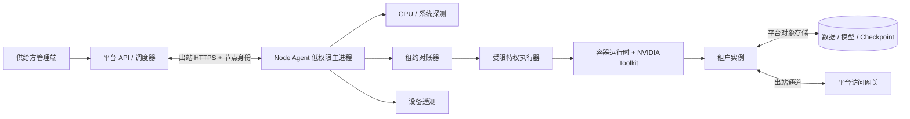

# uFreeGPU Node Agent 独立执行方案

状态：实施方案草案。总体业务与安全边界见 [BACKEND_ARCHITECTURE.md](BACKEND_ARCHITECTURE.md)。本文件规定 Agent 的首期交付范围、组件边界、控制协议、实施顺序和验收方法。

## 1. 首期交付目标

供给方在一台合格的 Linux GPU 主机上安装 Agent 后，平台可以识别每张 GPU、验证环境、将合格设备纳入候选池，并对一张整卡可靠地完成预留、启动、访问、监控、停止和资源清理。首期使用两台各有一张 4090 的测试主机验证：它们是两个独立节点，不能被误售为一个单机双卡实例。

**首期支持范围**：经认证的 Linux x86-64 环境、NVIDIA GPU、整卡独占、单主机单实例的基础路径；采用一套已验证的容器运行时和驱动兼容矩阵。先支持 SSH/Jupyter 访问以及平台对象存储的受控读写。

**首期暂不承诺**：Windows/WSL、AMD/Intel GPU、跨主机组合成一台多卡实例、自动无损迁移、任意驱动版本、任意镜像以及家庭网络下必然 P2P。节点通过硬件测试不等于通过租户数据隔离准入；未通过安全准入的个人主机仅用于合成测试，不承载租户工件。

## 2. 部署形态与职责



- **Agent 主进程**：Go 服务，以专用低权限账户运行，由 `systemd` 保活。负责注册、能力探测、心跳、状态对账、故障回报和升级状态；不直接提供给供给方的租户终端或文件接口。
- **受限特权执行器**：仅对启动/停止容器、设置 GPU 设备、资源限制和网络路由执行预定义操作。主进程经本地受权限保护的 Unix socket 调用它；执行器拒绝任意 shell、容器 `exec`、宿主路径读取和未经验证的参数。租户容器不得挂载宿主容器运行时 socket。
- **容器运行时适配**：首期选定并固定一种经测试的容器运行时配置；NVIDIA 驱动保留在宿主机，NVIDIA Container Toolkit 负责向容器暴露指定 GPU UUID。镜像用 digest 固定，按 CPU、RAM、PID、临时空间和设备权限设置限制。[NVIDIA Container Toolkit](https://docs.nvidia.com/datacenter/cloud-native/container-toolkit/latest/install-guide.html)、[OCI Linux 资源约束](https://specs.opencontainers.org/runtime-spec/config-linux/)
- **访问通道**：Agent/节点只主动连接平台网关，不开放家庭路由器入站端口；网关只转发归属当前租约的实例端口。控制消息与 SSH/Jupyter 流量分离，数据集和镜像不经控制 API 转发。直连优化延后，中继/网关是首期交付基线。
- **本地持久化**：仅保存节点身份、控制面版本、租约对账游标、运行时 ID 和未确认回执，可用 SQLite 事务日志实现；不保存租户代码、模型或对象存储长期密钥。

## 3. Agent 模块划分

| 模块 | 输入 | 输出与边界 |
| --- | --- | --- |
| `enrollment` | 一次性注册凭证 | 节点 ID、可轮换设备证书；凭证使用后失效 |
| `inventory` | NVML、系统与运行时接口 | 按 GPU UUID 的能力画像；不支持的指标标记为 unavailable |
| `qualification` | 标准测试镜像、网络/对象存储探针 | 结构化测试结果和错误码；不自行宣布可售 |
| `control` | 平台期望状态快照、租约续期 | 本地期望版本、心跳和观察状态回报 |
| `reconciler` | 期望状态、本地日志、实际容器/GPU 占用 | 幂等启动、停止、清理决定；旧版本拒绝 |
| `executor` | 经校验的受限操作 | 指定 GPU UUID 的容器与路由；无任意命令接口 |
| `tunnel` | 租约路由 ID、网关授权 | 当前实例的出站访问通道；不暴露宿主服务 |
| `telemetry` | GPU/主机健康数据 | 白名单指标、告警和故障码；无租户文件名、命令行或应用日志 |
| `updater` | 签名发布清单 | Agent 分批升级和回滚；不自动修改 GPU 驱动 |

GPU 探测优先使用 NVML 的结构化接口，以 GPU UUID 为设备主键。NVML 的温度、利用率、进程等字段可能随设备和驱动变化，不能假设每张消费级卡都完整支持；`nvidia-smi` 可用于诊断，不作为唯一解析来源。[NVIDIA NVML API](https://docs.nvidia.com/deploy/nvml-api/latest/index.html)

建议的代码边界：

```text
agent/
  cmd/ufreegpu-agent/       服务入口
  cmd/ufreegpu-executor/    受限特权执行器
  internal/enrollment/      节点身份与证书
  internal/inventory/       GPU、系统与网络探测
  internal/qualification/   准入测试
  internal/control/         平台协议与重连
  internal/reconcile/       租约状态对账
  internal/runtime/         容器运行时适配
  internal/tunnel/          访问通道适配
  internal/telemetry/       指标、事件和告警
  internal/state/           本地控制元数据
  packaging/               签名包与 systemd 单元
```

## 4. 控制协议与租约模型

**首期协议选择**：Agent 使用设备证书向平台 `HTTPS/443` 发起请求。期望状态采用带版本号的长轮询；心跳和观察状态单独上报。这样无需供给方开放端口，也便于在连接重建后获取完整快照。控制连接和访问通道各自重试，不能把 TCP 连接是否存活当作租约的唯一事实。规模和网络测试证明有必要时，再升级为流式协议。

| 端点/消息 | 用途 |
| --- | --- |
| `POST /agent/v1/enroll` | 使用一次性凭证换取节点身份；限制有效期和使用次数 |
| `POST /agent/v1/heartbeat` | 上报节点启动 ID、Agent 版本、能力摘要、当前期望版本与健康状态 |
| `GET /agent/v1/desired?since=<version>` | 长轮询期望租约快照；重连或版本不连续时拉取完整快照 |
| `POST /agent/v1/observations` | 批量上报租约阶段、运行时 ID、健康和结构化错误；带事件 ID 供服务端去重 |
| `POST /agent/v1/telemetry` | 上报限频的设备指标与告警，不传租户业务内容 |

注册接口以外的调用均验证设备证书、节点归属和协议版本。服务端是租约、库存和计费的权威；Agent 上报的“有空卡”只是候选信息，不能替代服务端原子预留。管理员端没有调用 Agent 任意操作的代理 API。

```text
DesiredLease {
  lease_id, generation, node_id, gpu_uuids[], image_digest,
  cpu_limit, ram_limit, scratch_limit, route_id,
  storage_grant_ref, lease_deadline, desired_phase
}

ObservedLease {
  lease_id, generation, node_boot_id, runtime_id,
  phase, health, started_at, last_checked_at, error_code
}
```

`generation` 是单调递增的防旧指令版本。Agent 对同一租约和版本重复收到的快照只能产生同一结果；旧版本拒绝执行。`lease_deadline` 需要续期并考虑时钟漂移。节点断网后不接新租约；已有实例在授权期限内按策略运行，到期则本地终止。断网期间主机重启后，Agent 必须重新连接平台确认租约，不能凭旧磁盘记录重新启动。

**节点状态**：`enrolling -> testing -> eligible -> draining/quarantined/offline`。只有 `eligible` 且心跳、能力测试与准入结果仍有效的节点参与调度。GPU UUID、驱动、运行时版本或关键网络能力发生变化时转入重新测试。

**实例观察状态**：`absent -> pulling -> starting -> healthy -> stopping -> cleaned`，每阶段允许进入 `failed` 并返回固定错误码。控制面在 Agent 报告 `healthy` 且访问网关探测成功后，才把实例设为可用并启动计费。

## 5. 一次租赁的执行序列

1. 供给方在 `frontend/admin` 创建节点申请，得到短期注册凭证；安装签名 Agent 包并启动服务。
2. Agent 注册并上报硬件画像；运行标准 CUDA 镜像、显存分配、稳定性、网络和平台对象存储连通性测试。控制面审核通过后发布对应 GPU UUID 的商品。
3. 租户在 `frontend/web` 下单；调度器在数据库中原子预留该 GPU UUID，写入期望租约及其版本。A、B 各一张 4090 时，只能得到两个分别属于不同主机的单卡商品。
4. Agent 对账期望租约，检查 GPU 仍空闲、宿主驱动和镜像兼容，预拉取镜像并通过受限执行器启动工作负载；运行时仅分配租约指定的 GPU。
5. Agent 建立出站访问通道并上报健康；平台从网关侧验证租户可连接。任何一步失败，租约转入失败处理，清理容器与路由并释放或隔离资源。
6. 运行期间 Agent 定期上报白名单硬件指标、续租约并执行温度保护；租户数据按第 6 节总体架构的规则与平台对象存储交互，Agent 不承载大文件转发。
7. 租户释放、余额耗尽或租约到期时，控制面更新期望状态。Agent 停止容器、撤销路由、清理临时资源并回报；控制面核对后释放 GPU 和完成账务。

## 6. 错误处理与状态收敛

| 故障 | Agent 行为 | 控制面行为 |
| --- | --- | --- |
| 重复或乱序期望租约 | 按 `lease_id + generation` 去重或拒绝旧版本 | 不重复创建实例和账单 |
| 镜像拉取失败 | 返回 `IMAGE_PULL_FAILED`，删除不完整层和路由 | 释放预留或按策略重试，不开始计费 |
| 驱动/CUDA 不兼容 | 返回 `DRIVER_INCOMPATIBLE` 并撤销该能力画像 | 节点重新测试，其他兼容节点可重新匹配 |
| GPU UUID 不见或被占用 | 返回 `GPU_NOT_AVAILABLE`，停止接新任务 | 隔离设备，避免超卖 |
| 网关不可达 | 容器可短暂等待通道恢复，不宣告可用 | 不开始新实例计费；按超时策略清理或补偿 |
| Agent 进程重启 | 从本地控制元数据和运行时查询实例，重新拉取期望状态 | 保持租约待对账，未确认清理前不重新出售 GPU |
| 家庭网络中断 | 停止接单，现有租约依期限和策略处理 | 标记 `suspect`，停止新分配；费用按服务端规则核对 |
| GPU 过热/掉卡 | 停止接单，告警；严重故障安全终止任务 | 节点隔离，通知租户并执行退款/恢复流程 |
| 对象存储不可达 | 上报 `STORAGE_UNREACHABLE`，任务按工作负载策略等待或失败 | 不承诺未提交成功的 Checkpoint 可恢复 |

本地状态日志只保证 Agent 在正常故障和重启后恢复对账能力，不是资源分配权威。若本地日志损坏或实际容器与租约矛盾，节点进入 `quarantined`，阻止继续调度并等待人工诊断。

## 7. 分阶段实施与验收门槛

| 阶段 | 交付物 | 必须通过的验收 |
| --- | --- | --- |
| P0：契约与测试台 | Agent 协议、错误码、设备/租约状态机；两台 GPU 测试机和可模拟断网的环境 | 期望状态、计费起止和各方责任无歧义；A/B 两张卡不能组成单机双卡 |
| P1：安装与探测 | 签名安装包、`systemd` 服务、注册和证书轮换、NVML 画像、驱动/CUDA/网络测试 | 重装和重启后节点身份正确；不同驱动不误报兼容；测试未通过不上架 |
| P2：租约执行 | 长轮询协议、本地状态日志、对账器、受限执行器、容器 GPU UUID 分配 | 同一 GPU 并发下单不超卖；重复/乱序指令不重复启动；失败清理可重试 |
| P3：交付链路 | 出站网关通道、镜像预拉取、对象存储访问、SSH/Jupyter 健康探测 | 只有网关验证可访问后实例进入可用；节点磁盘不作为租户持久卷 |
| P4：故障与观测 | 心跳、温控、告警、结构化错误、断网和重启对账、账务核对 | 拔网线、关机、GPU 掉卡、镜像失败和存储故障后最终状态收敛，费用不重复 |
| P5：受控发布 | 分批升级、回滚、版本兼容策略、安装与排障文档 | 小规模真实节点长期运行，升级不静默改动驱动且可回滚 |

每个阶段先在受控测试机验证，再扩大节点数量。P3 完成前不能把商品显示为可交付；P4 完成前不能扩大供给方规模。上线指标至少包括节点在线率、下单到可连接的时间分布、镜像冷启动失败率、实例运行中断率、租约对账耗时、GPU 占用与账本差异数。阈值应通过测试台和试运营数据确定，不在实现前凭空承诺。

## 8. 首期实施顺序与接口依赖

1. Backend 先定义 `Host`、`GpuDevice`、`NodeQualification`、`Lease` 的数据库约束及 Agent OpenAPI 契约；完成原子 GPU 预留与期望状态表。
2. Agent 实现 P1 探测，控制面把真实节点资格和指标接到 `frontend/admin`；此阶段只运行合成测试。
3. 实现 P2 对账器与容器运行时，在两台测试主机跑单卡测试镜像；验证重复和乱序租约。
4. 实现 P3 网关与对象存储访问，将 `frontend/web` 的模拟下单、SSH/Jupyter 入口改为服务端状态。
5. 完成 P4 故障注入和计费对账，再开始 P5 小范围供给方发布。

访问网关的隧道实现应在 P0/P3 做独立选型验证：要求出站可达、租约级授权、并发复用、断线重连、延迟/吞吐可测和服务端可撤销；优先采用经过维护的成熟组件，不在 Agent 中临时自造网络协议。直连、NAT 打洞和跨节点训练均不阻塞首期闭环。
