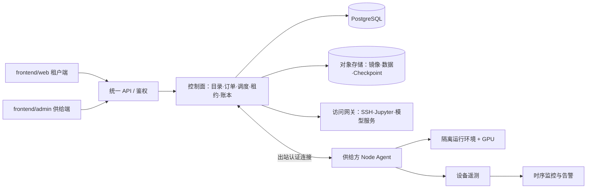
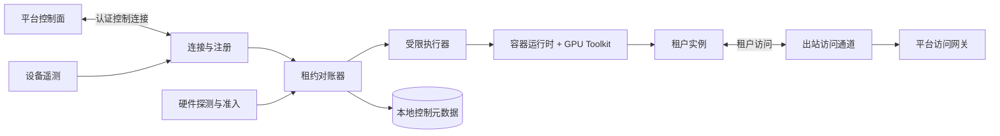

# uFreeGPU Backend 总体技术架构方案

状态：方案草案。本文用于指导 `frontend/web`（租户端）、`frontend/admin`（供给方管理端）对应的后端设计；具体安全等级、计费规则和 SLA 需要在实施前确认。

## 1. 目标与边界

平台的核心能力是把供给方主机上的闲置 GPU 登记为可分配资源，为租户创建有明确状态、时长和费用的资源租约，并完成运行、访问、监控与结算闭环。商品可以按 GPU 定价，但一次计算仍需要该主机提供最低限度的 CPU、RAM、网络和临时运行空间。

**强制访问原则**：出租期间，只有租户身份可以登录其租赁实例。供给方只能在管理端查看经过筛选的设备运行指标、告警、租约状态和收益；供给方及平台运维人员均不获得租户实例的 SSH、Jupyter、VNC、控制台或文件访问凭证，也不能通过管理 API 查看租户代码、模型、数据集、密钥或应用日志。

首期支持单机、整卡独占的交互式 GPU 实例（SSH/Jupyter）。批量训练、长期在线模型服务、多机训练和自动故障恢复按阶段增加。个人设备和机构机房都须通过租户数据隔离准入，不能仅凭安装 Agent 就进入承载租户代码、模型和数据的资源池。

现有两个前端均为交互原型，资源、订单、收益和监控数据不能作为服务端真实状态。租赁端的 `GpuNode`、`UserInstance`、`ProviderWorker` 可作为 API 需求输入，后端应重新定义持久化实体与状态机。

## 2. 总体架构



**控制面**负责身份和权限、供给方与节点注册、资源目录、租赁订单、原子预留、实例生命周期、价格快照、用量核对、账本与结算。首期建议实现为模块化单体服务加独立调度 worker，不必先拆成多个微服务。

**数据面**由安装在供给方主机上的 Agent、容器或虚拟机运行环境、访问网关及对象存储构成。Agent 主动连接控制面，不要求家庭网络开放入站端口；租户仅通过平台授权的访问通道连接工作负载。

**部署建议**：受控机构机房可使用 Kubernetes、NVIDIA GPU Operator 与设备插件统一管理；个人主机通过 Agent 接入，不直接加入平台 Kubernetes 集群。Kubernetes 对 GPU 的调度依赖硬件厂商设备插件，GPU Operator 可协助管理驱动、容器工具链、设备插件和遥测组件。[Kubernetes GPU 调度](https://kubernetes.io/docs/tasks/manage-gpus/scheduling-gpus/)、[NVIDIA GPU Operator](https://docs.nvidia.com/datacenter/cloud-native/gpu-operator/latest/index.html)

## 3. 闲置 GPU 出租的端到端流程

1. **注册和审核**：供给方创建节点申请，服务端发放短期、一次性接入凭证。Agent 使用该凭证完成首次注册，之后使用独立设备身份与控制面建立认证连接。Agent 报告 GPU UUID、型号、显存、驱动、CPU/内存、网络、温度、可用时段及基准测试结果。服务端分别完成兼容性验证和租户数据隔离准入；两者都通过后才发布可售资源。
2. **发布供给**：供给方设置价格、可出租时段、温度保护阈值和接单策略。服务端对可售配置进行版本化；运行中的订单保持下单时的价格快照。
3. **下单和预留**：租户提交型号、卡数、地区、镜像、运行模式、预算及所需可信等级。调度器先做硬条件过滤，再按价格、网络质量、可靠性等排序；通过数据库事务锁定具体 GPU UUID，创建有过期时间的预留，防止超卖。
4. **启动和交付**：控制面向 Agent 下发带租约 ID、版本号和过期时间的指令。Agent 拉取受控镜像，将指定整卡分配给隔离工作负载。镜像启动、健康检查和访问通道均成功后，实例进入 `running` 并开始计费。超时或失败则释放预留并撤销访问权限。
5. **运行和访问**：只有该租约所属租户经网关取得短期 SSH、Jupyter 或模型服务访问授权。供给方账户没有实例访问权限；Agent 仅执行受控生命周期指令，不签发租户登录凭证。节点与网关优先尝试直连，无法直连时使用受控中继；不能假定所有 NAT 环境都能 P2P，也不能承诺固定延迟。[连接方式与中继回退参考](https://tailscale.com/docs/reference/connection-types)
6. **停止和结算**：控制面停止工作负载、撤销访问凭证、释放 GPU、生成最终用量与账本流水。所有步骤必须可重试，并以租约 ID 保证幂等。

### 3.1 散户异构 GPU 如何接入

计算任务实际运行在供给方主机上，租户通过授权网关远程进入实例；平台不会把一张 PCIe GPU 直接“映射”到租户电脑。硬件型号、驱动与家庭网络的差异由节点准入流水线和调度匹配处理，不能靠前端填写型号后直接上架。

| 阶段 | Agent / 控制面操作 | 不通过时 |
| --- | --- | --- |
| 注册 | 供给方取得一次性注册凭证，安装经签名的 Agent；Agent 换取节点身份凭证，仅建立主动出站连接 | 保留申请，撤销凭证，不进入资源目录 |
| 硬件发现 | 通过 NVML 等结构化接口识别每张卡的 GPU UUID、型号、显存、计算能力、驱动与健康状态；同时探测 CPU、内存、磁盘、系统和网络 | 标记具体不兼容原因；未知型号不自动拒绝，但须经实测 |
| 运行时验证 | 检查宿主驱动、容器运行时和 NVIDIA Container Toolkit；确认待出租 GPU 没有本地主机任务占用；运行测试镜像及短时 CUDA 计算、显存分配和温度测试 | 不自动升级或替换供给方驱动；提示修复后重新测试 |
| 网络验证 | Agent 经出站 HTTPS/443 连接控制面和访问网关，测试心跳稳定性、可用带宽、时延、抖动及中继路径 | 不能满足最低要求的节点保持待修复，不接受订单 |
| 安全准入 | 校验主机控制权、可信等级、隔离运行能力和租户数据保护条件 | 非受控个人主机仅保留设备画像与合成测试资格，不承载租户工件 |
| 发布 | 生成带版本的设备能力画像和可售规格；调度器只使用最近验证通过、心跳新鲜的资源 | 测试过期、驱动变更、GPU 更换或健康异常时自动撤销可售资格 |

**GPU 型号不写死为少量枚举。** 设备记录保存 NVIDIA 原始型号和 GPU UUID，平台再映射为搜索用商品规格（例如“RTX 4090 / 24 GB / 整卡”）。调度条件使用实测能力：显存下限、计算能力、镜像要求的驱动/CUDA 兼容范围、单机卡数、互联能力及健康评分。不同 CUDA Toolkit 与宿主驱动并非任意组合；以官方兼容性要求加启动前的实际计算测试为准。[NVIDIA CUDA 兼容性](https://docs.nvidia.com/deploy/cuda-compatibility/latest/index.html)、[NVML API](https://docs.nvidia.com/deploy/nvml-api/nvml-api-reference.html)

**驱动留在宿主机，应用环境放进镜像。** Agent 读取宿主驱动与运行时能力；租户镜像声明最低驱动、CUDA、计算能力和显存需求。NVIDIA Container Toolkit 让容器使用宿主 GPU，但不替平台消除驱动兼容性问题。首期只认证一组 Linux、驱动和运行时组合；Windows/WSL、未知驱动分支和跨厂商 GPU 后续再支持。[NVIDIA Container Toolkit 安装要求](https://docs.nvidia.com/datacenter/cloud-native/container-toolkit/latest/install-guide.html)

**家庭宽带不要求公网 IP。** Agent 发起并维持到平台的出站认证连接；SSH/Jupyter 由访问网关转发，能直连时可优化路径，不能直连时必须有中继回退。网络评分应区分直连与中继的吞吐、成本和稳定性，并持续更新；NAT 打洞成功率不是上架条件的唯一指标。[直连与中继机制参考](https://tailscale.com/docs/reference/connection-types)

兼容性合格与安全合格是两个独立结果。一张能稳定跑 CUDA 的散户 RTX 4090，仍不自动满足“供给方无法触碰租户代码和模型”的要求；在该硬约束下，普通非受控个人主机不能进入正式租赁池。平台需要让个人供给方选择符合准入条件的受控托管模式，或接入能够完成所需机密计算证明的硬件；否则只能停留在设备登记和合成基准测试阶段。

### 3.2 A、B 各出租一张 4090 时的资源展示与调度

以下示例以 A、B 两个节点**均通过前述安全准入**为前提。两张卡型号相同，但分属不同的物理主机、网络和供给方。

| 资源 | 物理归属 | 商品规格 | 同机可用卡数 |
| --- | --- | --- | --- |
| GPU-A | Host-A / Provider-A | RTX 4090 / 24 GB / 整卡 | 1 |
| GPU-B | Host-B / Provider-B | RTX 4090 / 24 GB / 整卡 | 1 |

商城的“RTX 4090 可用 2 卡”只是**按型号汇总的库存**，不代表存在“单机 2×4090”实例。商品列表应分别展示 Host-A 和 Host-B 的价格、地区、网络质量及可信等级；也可以提供“自动分配 1 卡”，由调度器从合格的单卡商品中选择。

| 租户需求 | 结果 |
| --- | --- |
| 1 卡 4090 交互式实例 | 预留 GPU-A 或 GPU-B 中的一张，创建一个实例、一个访问地址和一份租约 |
| 2 卡 4090 **单机实例** | A、B 各只有一张，不能满足；只有同一合格主机至少两张空闲卡才可售 |
| 两个独立的 1 卡实例 | 可以分别在 A、B 创建两个实例；分别计费、访问和故障处理，不能伪装成一个双卡实例 |
| 2 节点分布式训练 | 需租户明确选择分布式任务，平台建立两个节点间的受控通信并验证带宽、时延、镜像和框架兼容性；作为后续独立产品能力 |

两张 24 GB 显卡也不会自动变成一张 48 GB 显卡。普通数据并行训练会在每张卡上运行各自的进程与模型副本；跨主机模型切分需要应用和框架明确支持，并受节点间网络影响。PyTorch 的多节点训练需要可互通的机器和分布式启动方式，其教程也指出跨节点通信延迟会成为瓶颈。[PyTorch 多节点训练](https://docs.pytorch.org/tutorials/intermediate/ddp_series_multinode)

实现上，`GpuDevice` 对应具体 GPU UUID，`Offering` 对应单个可售节点上的配置，`GpuSku` 或目录聚合视图用于显示型号库存。单机多卡订单必须在**同一 Host** 上事务性预留所需数量的 GPU UUID；不允许调度器为单机实例从 A、B 各取一张。市场显示的汇总数量仅用于发现资源，提交订单时必须重新校验并原子预留，防止两个租户同时抢到同一张卡。

前后端契约也应区分两个数字：`total_available_by_model=2` 表示全平台同型号库存，`available_on_host=1` 表示某个商品可用于**单机实例**的卡数。按“单机 2 卡”筛选时，API 只返回 `available_on_host >= 2` 的商品；A、B 这个例子返回空列表。创建实例请求必须指定商品/节点、`gpu_count` 和 `placement=single_host`，由后端最终核验；租两个独立实例则创建两笔各 1 卡的租约，不能把前端显示的总库存直接提交为一个双卡实例。

若租户正在使用 A，而 A 断线，B 的空闲卡也不能自动接管正在运行的内存状态。只有租户任务保存了可用 Checkpoint、B 满足镜像与安全要求、且调度器成功取得新租约时，才能在 B 上重新启动；恢复期间的中断和可能丢失的进度必须向租户展示。

## 4. 核心状态与一致性

```text
requested -> reserved -> provisioning -> running -> stopping -> terminated
                   |             |           |
                   +--> failed <--+-----------+
                                      |
                                  suspect -> lost
```

- 每张物理 GPU 使用稳定 GPU UUID 标识。数据库对“同一 GPU 同一时刻只有一个有效独占租约”提供事务约束；缓存只做候选资源加速，不是分配事实来源。
- 预留设置 TTL。每次调度指令包含单调递增的租约版本（fencing token）；Agent 拒绝旧指令，避免重试和网络延迟导致重复启动。
- 心跳中断先进入 `suspect`。租约超时后停止新任务分配，按已确认的服务时间结算，并触发恢复或退款流程。Agent 在控制面失联时也应依据本地租约期限停止工作负载；对恶意或失控主机无法依赖该机制做绝对保证。
- 停止、退款和重新调度使用持久化状态机及幂等事件处理。不要让前端按钮或 Agent 单方声明决定最终订单状态。

## 5. 隔离、安全与可信等级

### 5.1 实例访问控制

- 每个租赁实例拥有独立的租户身份、网络命名空间、运行环境与短期连接凭证。访问网关必须同时检查租户身份、实例归属、租约状态及凭证期限；实例停止或租约到期立即撤销凭证。
- 供给方 RBAC 仅允许设备接入、上下架、定价、健康监控、告警确认和收益查询。`frontend/admin` 不提供终端、文件浏览器、租户容器 `exec`、模型下载或应用日志入口；后端即使收到直接调用也必须拒绝。
- 平台运维默认同样没有租户实例登录权限。故障处理使用节点健康、租约状态和受控重启/终止操作，不提供绕过租户身份的通用“超级管理员登录”。
- Agent 的管理通道只能接收签名、限范围的生命周期指令；不能把宿主机 shell、任意文件读取、容器 `exec` 或租户密钥访问能力暴露给供给方管理端。
- 管理端遥测采用字段白名单：GPU 利用率、显存用量、温度、功耗、设备错误、节点 CPU/内存/网络汇总、心跳与租约状态。不得采集或展示租户进程命令行、环境变量、文件名/路径、代码片段、模型名称、数据内容、应用 stdout/stderr 或租户连接令牌。

### 5.2 宿主机威胁边界

以上规则能确保**平台正常访问路径**只有租户可以登录实例，却不能阻止掌握物理设备或宿主机管理员权限的人绕过平台，观察内存、磁盘或 GPU 上的运行数据。普通容器、GPU 直通虚拟机、传输加密和静态加密都不能单独给非受控个人主机提供“供给方绝对无法触碰代码或模型”的保证。

| 节点等级 | 准入方式 | 可对租户承诺的边界 |
| --- | --- | --- |
| 非受控个人节点 | Agent 接入、整卡独占、隔离运行、供给方无平台实例入口 | 仅可做接入验证和合成基准测试；不进入实际租户工作负载资源池 |
| 平台受控节点 | 平台掌握宿主机运维权限，供给方不持有宿主登录凭证；采用设备审计和租户隔离 | 降低供给方直接访问风险，但仍需把平台运维和物理控制纳入信任模型 |
| 机密计算节点 | 经验证的 CPU TEE + 支持机密计算的 GPU、机密 VM、远程证明、证明通过后才释放租户密钥 | 按验证通过的具体硬件与威胁模型提供对宿主管理员的保密保护 |

**准入门槛**：本产品将“供给方无法通过平台登录租户实例或读取租户工件”作为所有正式节点的共同要求。若进一步承诺“原宿主机所有者或管理员也无法读取明文”，节点必须满足对应的托管与技术证明条件；非受控个人主机不得上线承载租户工作负载。普通 RTX 3090/4090 个人主机不能包装成机密计算资源。NVIDIA 的机密计算有明确的 GPU 和主机平台支持范围。[NVIDIA 机密计算支持范围](https://docs.nvidia.com/confidential-computing/containers/supported-platforms)

高保密等级下，租户工件应先加密；CPU 与 GPU 证明均通过、工作负载镜像符合租户策略后，密钥服务才向机密 VM 内部释放解密密钥。任何处理明文模型、提示词、输出或中间张量的组件均必须位于可信边界内。这个模式需要专门实现和验证，不能由普通 Agent 安装自动获得。[NVIDIA 自托管机密 VM 架构](https://docs.nvidia.com/enterprise-reference-architectures/deploying-proprietary-models-confidential-compute-self-hosted-vms/latest/architecture-summary.html)、[CPU/GPU 证明与密钥释放要求](https://docs.nvidia.com/confidential-computing/virtual-machines/threat-model)

消费级 GPU 首期按整卡独占。支持 MIG 的数据中心 GPU 可在后续作为独立产品规格接入，不应将软件共享等同于硬件隔离；需按官方支持清单逐型号验证。[NVIDIA MIG 支持列表](https://docs.nvidia.com/datacenter/tesla/mig-user-guide/latest/supported-gpus.html)

Agent 不应接受前端直接提交的 shell 指令。安装凭证短期有效且只可使用一次；运行指令由控制面认证、授权并审计。租户镜像采用允许列表或扫描与签名策略，容器禁用特权模式、限制设备访问及宿主挂载，并对供给方主机提供单独的风险提示。

## 6. 存储、访问和故障恢复

### 6.1 平台对象存储与节点数据路径

**持久层在 uFreeGPU。** 租户上传的数据集、代码包、模型权重、训练输出和 Checkpoint 按租户隔离保存在平台对象存储中，并由平台负责版本、配额、加密、备份与删除。供给方的本地磁盘不是租户持久卷，节点退出或更换后仍可从对象存储恢复持久数据。

```text
租户上传 -> uFreeGPU 对象存储 -> 受授权的运行实例按需读取 -> RAM / GPU 显存中计算
租户实例写出 Checkpoint / 结果 -> uFreeGPU 对象存储 -> 租户下载或新节点恢复
```

首期优先使用面向对象存储的读取器和上传器：按块/范围读取、并发预取、限流，训练结果与 Checkpoint 使用临时对象写入、校验成功后再发布。需要文件系统路径的应用可增加挂载层，但应核对其 POSIX 语义、缓存和写入行为；对象存储挂载不自动等于本地磁盘。大文件数据流不经过控制面 API，使用租户与租约限定的短时授权。可缓存不含租户工件的公共基础镜像；若镜像含私有代码或模型，不得在供给方磁盘留下永久镜像层。高保密等级的解密密钥不能交给宿主机或供给方 Agent。

**不占用本地磁盘持久空间**与**完全不占用本地内存**不同。镜像运行、数据加载、模型计算仍要使用宿主 CPU/RAM 和 GPU 显存；内核页缓存、应用预取或文件系统客户端也可能使用临时内存。即使把磁盘缓存禁用，无法让通用训练任务做到零 RAM/VRAM 占用。调度器因此必须同时预留最低 CPU、RAM、显存与网络能力，并对临时缓冲设上限。若允许加密临时盘，须明确配额、租约结束清理和敏感数据残留风险；严格零本地持久数据的产品模式不得启用本地文件缓存或写回缓存。

远程对象存储会把训练 I/O 变成网络依赖。家庭宽带下，大型数据集的重复随机读取可能使 GPU 长时间等待、增加流量费用；准入测试要测量平台对象存储到节点的持续吞吐和时延，并按工作负载设置最低要求。缓存和并行读取能改善性能，但缓存本身占用 RAM 或本地盘。[JuiceFS 缓存机制](https://juicefs.com/docs/community/guide/cache/)、[S3 性能设计](https://docs.aws.amazon.com/AmazonS3/latest/userguide/optimizing-performance-design-patterns.html)

**安全边界不变**：数据只在平台对象存储持久化，仍不意味着非受控宿主机所有者无法观察运行中的明文、进程内存或 GPU 显存。第 5 节的托管/机密计算准入要求继续适用；对象存储不能代替租户运行时隔离。

### 6.2 访问与恢复

- SSH/Jupyter/模型服务经租户身份、实例归属和短时访问令牌完成网关授权。网关记录连接归属、租约状态和审计事件，避免直接暴露供给方宿主端口；供给方无法取得租户访问令牌。
- 宿主机重启、网络断开或设备故障时，供给方仍可能影响服务可用性。访问隔离不等于可用性保证，需通过监控、租约超时、退款和可恢复任务设计处理。
- Checkpoint 是训练应用协作能力，需要框架或用户任务实际写入并验证可恢复文件。节点失联时只能从最近一次有效 Checkpoint 在兼容节点恢复；未保存的训练进度可能丢失。
- 在线模型服务优先调度到稳定的机构节点。个人设备只有完成平台受控托管或符合可验证的机密执行条件后，才能承载实际租户实例；可中断实例也不能豁免租户数据隔离要求。

## 7. 计费、账本与对账

首期建议按**独占 GPU 租约时长**计费，而非按 GPU 利用率计费。计费起点为服务端确认实例可用，终点为资源释放确认或租约失联截止点。价格、折扣及费率在下单时形成不可变快照；金额以整数分存储。

需要明确“暂停”是否仍占卡：若占卡，通常继续收取资源占用费；若不收费，应释放 GPU，恢复时重新调度。余额预授权、扣费、退款、供给方应收与平台收入应进入可审计账本。Agent 遥测用于核对和反作弊，不能独立决定费用或提现金额。

平台对象存储容量、请求量及传输流量应单独核算，不隐含在 GPU 秒单价中。供给方虽然以 GPU 供给为商品入口，运行时仍提供 CPU、RAM、家庭网络和电力；准入与供给方结算规则需要覆盖这些资源，并明确断网、限速及流量成本由谁承担。

## 8. 数据实体与 API 边界

核心实体：`Provider`、`Host`、`GpuDevice`、`CapabilitySnapshot`、`NodeQualification`、`GpuSku`、`Offering`、`Order`、`Reservation`、`Lease`、`Instance`、`StorageObject`、`UsageInterval`、`LedgerEntry`、`Payout`、`NodeEvent`。物理设备、实测能力、准入结果、型号聚合、可售商品、持久工件和一次租约必须分开建模；跨节点任务后续另建调度组，不复用单机实例语义。

| 客户端 | 首期 API 能力 |
| --- | --- |
| `frontend/admin` | 节点注册与审核进度、设备清单、上/下架、价格和策略、白名单遥测与设备告警、订单汇总、收益与提现；无租户终端、文件、应用日志及密钥 API |
| `frontend/web` | 商品搜索、报价、创建订单、实例状态、启停与释放、仅限所属实例的连接凭证、用量和账单 |
| Node Agent | 设备注册、心跳、白名单设备遥测、受控指令拉取/回执、租约状态、工作负载启动和清理；不向供给方返回租户工件或登录凭证 |

前端不能自行生成权威订单号、SSH 端口、账单金额或接入凭证。所有写接口应支持幂等键；实例状态变化通过查询或订阅服务端事件更新。

当前租赁端的商品和 GPU 数量筛选仍使用演示数据。对接 backend 后，应由 API 分别返回型号聚合库存与节点级商品；“选择 2 卡”筛选的是**单个节点有至少两张合格空闲卡**，不能只检查全平台汇总库存。

## 9. 技术选型与可观测性

- **建议首期**：Go 实现控制面、调度 worker 和 Agent；PostgreSQL 存储权威业务状态；S3 兼容对象存储保存镜像相关资产、数据与 Checkpoint；Redis 仅用于缓存、限流和短期协作，不承担唯一分配状态。
- **运行环境**：受控节点使用 NVIDIA Container Toolkit；机构 Kubernetes 池可采用 GPU Operator。个人节点先限定经验证的 Linux/驱动/运行时组合，Windows/WSL 不纳入首期承诺。
- **监控**：控制面采集 API、调度、租约和账本指标；节点只向供给方视图提供白名单硬件指标，例如心跳、GPU 温度、显存用量、功耗、错误码及网络质量。指标标签也需过滤租户标识、文件路径和应用信息。DCGM Exporter 可提供 GPU 指标，但实际可用字段取决于 GPU、驱动、权限和部署方式，UI 必须允许“指标不可用”。[NVIDIA DCGM 指标说明](https://docs.nvidia.com/datacenter/dcgm/latest/reference/dcgm-exporter-metrics.html)
- **事件链路**：初期可使用数据库 outbox 与 worker；规模扩大后再引入消息系统。每个订单、租约和 Agent 指令保留关联 ID，便于排查故障和账务争议。

### 9.1 Node Agent 技术架构

具体模块、控制协议、实施阶段和故障验收见独立的 [Node Agent 执行方案](AGENT_EXECUTION_PLAN.md)。

Agent 是安装在供给方 GPU 主机上的**独立后台软件**，不是要求供给方应用集成的 SDK。首期建议 Go 实现、签名软件包安装、由 Linux `systemd` 管理。它依赖已安装且经验证的 NVIDIA 驱动和容器运行时，不替换驱动；首期认证一种运行时配置，其他运行时通过适配层逐步加入。租户 SDK 将来只用于任务进度、Checkpoint 等应用内功能，不能代替主机 Agent。



| Agent 模块 | 职责 |
| --- | --- |
| 注册与凭证 | 一次性注册凭证换取节点身份；证书轮换、吊销和 Agent 版本校验；只允许节点主动建立出站连接 |
| 能力探测 | 使用 NVML 等接口按 GPU UUID 探测型号、显存、温度、功耗、健康与驱动；测试容器 CUDA、CPU/RAM、磁盘临时空间及网络，不把设备序号当稳定 ID |
| 控制连接 | 与控制面维持认证连接，接收期望租约、上报回执和心跳；断线采用退避重连，不能依赖连接本身代表任务已停止 |
| 租约对账器 | 比较控制面期望状态、本地持久化元数据及运行时实际状态；按租约 ID 和版本去重、启动、停止、清理，拒绝过期指令 |
| 受限执行器与运行时适配 | 只接受明确的操作类型，按镜像 digest 启动容器，注入指定 GPU UUID，设置 CPU/RAM/PID/临时盘配额；不提供任意宿主 shell 或租户容器 `exec` |
| 出站访问通道 | 将实例内获授权的 SSH/Jupyter/服务端口接入平台网关；控制消息与大文件/数据集传输分开，后者走对象存储 |
| 本地设备保护 | 监测温度、掉卡、功耗及风扇异常；达到供给方确认的阈值时停止接新任务并上报告警，严重故障按租约策略安全终止任务 |
| 遥测与本地状态 | 仅上报设备指标白名单、状态和错误码；本地持久化节点身份、最近租约版本、运行时 ID 和待上报回执，不持久化租户业务内容 |

NVML 可提供 GPU UUID、利用率、显存、温度、功耗等信息，但字段支持随产品与驱动而异；Agent 必须将“不支持/不可读取”作为正常结果处理。[NVIDIA NVML API](https://docs.nvidia.com/deploy/nvml-api/latest/index.html) GPU 绑定使用 UUID 而不是会随设备枚举变化的序号；NVIDIA Container Toolkit 支持按 UUID 指定容器可用 GPU。[按 UUID 选择 GPU](https://docs.nvidia.com/datacenter/cloud-native/container-toolkit/latest/docker-specialized.html)

**主进程与宿主权限分离**：连接、探测、状态对账尽量以专用低权限账户运行；启动容器、设置设备与网络的宿主操作交给最小化的本地特权执行器。执行器只接收经校验的租约描述和允许列表操作，不接受管理端透传命令。租户容器不能挂载宿主的容器运行时套接字，也不能反向调用 Agent 管理接口。容器 CPU、内存、进程数及设备访问由运行时资源限制落实。[OCI Linux 资源约束](https://specs.opencontainers.org/runtime-spec/config-linux/)

**控制协议采用期望状态与回报状态**，而不是单次“执行成功”消息。核心字段可先定义为：

```text
DesiredLease { lease_id, generation, deadline, gpu_uuids[], image_digest,
               cpu_limit, ram_limit, scratch_limit, route_id, storage_grant_ref }
ObservedLease { lease_id, generation, phase, runtime_id, started_at,
                health, error_code }
```

控制面是租约和计费的权威来源。Agent 收到 `DesiredLease` 后先验证节点身份、版本、期限、GPU UUID、镜像摘要与资源配额，再启动并健康检查；只有上报 `ObservedLease=running` 且网关可连接，控制面才将实例置为可用。重复收到同一 `generation` 不重复启动；旧版本被拒绝；更新版本只执行允许的状态变化。镜像拉取或启动失败要返回结构化错误并清理占用。控制连接可使用双向认证的 gRPC/HTTP2，兼容受限网络的 HTTPS 拉取/长轮询可作为回退；传输重试不代替租约幂等处理。[gRPC 重试机制](https://grpc.io/docs/guides/retry/)

**节点重启和断网恢复**：Agent 启动时先读取本地控制元数据、查询运行时实际容器与 GPU 占用，再向控制面请求当前期望状态；有冲突时将节点设为不可调度，待对账完成。连接丢失期间不接新租约，已有实例只在已授权的租约期限内继续运行；到期后 Agent 本地停止并尝试清理。节点在断网期间重启时不能仅凭旧缓存重新启动实例，须先向控制面重新确认租约。租约截止时间应考虑节点时钟漂移和重启，不能只依赖可被更改的本地墙上时间。控制面不能因为暂时收不到心跳，就在原租约可能仍运行时把同一张 GPU 分给别人。重新连接后补发有序回执，最终状态和费用按服务端规则核对。

**准入与升级**：首次安装只做合成测试；通过硬件、驱动、镜像启动、网络和第 5 节安全准入后才发布可售设备。驱动变化、GPU UUID 变化、Agent 版本不兼容、持续温度异常或控制状态无法收敛时自动退出可调度池。Agent 升级采用签名版本、分批发布与回滚，不在运行中静默改动宿主 GPU 驱动。

**必须覆盖的故障测试**：两笔订单同时抢一张 GPU、重复/乱序租约指令、镜像拉取失败、Agent 进程重启、宿主机重启、连续断网、网关断开、GPU 掉卡、驱动更新后能力变化、租约过期后容器残留，以及对象存储不可达。验收不只看 Agent 是否在线，还看 GPU 不超卖、实例状态可收敛、访问权限及时撤销、临时数据清理和计费不重复。

## 10. 实施阶段与验收

1. **受控节点闭环**：少量审核通过的 Linux 主机，完成注册、整卡独占、下单预留、平台对象存储读写、实例启动/停止、租户独占访问网关和按时计费。验收重点：并发下单不超卖、失败预留能回收、重复请求不重复扣费；实例重建后持久工件仍可读取、租约结束后供给方磁盘无租户持久副本；供给方及平台运维账户无法经 API、SSH、Jupyter 或管理 UI 进入租户实例，也无法读取代码、模型或应用日志。
2. **开放供给**：个人节点审核、平台托管/硬件证明准入、网络中继、设备健康评分、温控保护、白名单告警、供给方收益账本与提现对账。验收重点：拔网线/断电后资源和计费状态可收敛，失联期间不产生不可解释费用；未达到租户数据隔离准入条件的个人节点不能被调度给租户。
3. **高级工作负载**：机构池 MIG、多卡训练、持久数据盘、Checkpoint 恢复、长期在线推理及更高可信等级。分别测试恢复时间与数据损失窗口，不承诺通用的秒级无损迁移。

## 11. 实施前需要确认的产品决策

1. 个人节点是否允许租户运行任意代码，还是只运行经过审核的镜像/任务？
2. 哪些业务必须达到“宿主机管理员也无法读取明文”的机密计算等级？这一要求已经不能仅靠前端或普通个人主机上的容器实现。
3. 暂停实例时 GPU 是否继续保留，如何收费？
4. 节点离线后的停止计费、退款、恢复时限和可接受的数据损失窗口是什么？
5. 首期覆盖哪些地区、支付方式以及个人和机构供给方结算方式？

当前前端的接入测试、P2P、账单与故障迁移均是演示流程。正式联调时应以本方案定义的服务端状态和实际能力替换；尤其不能把固定安装令牌、必然 P2P、未经验证的绝对数据保密或“数秒无损迁移”作为上线承诺。
